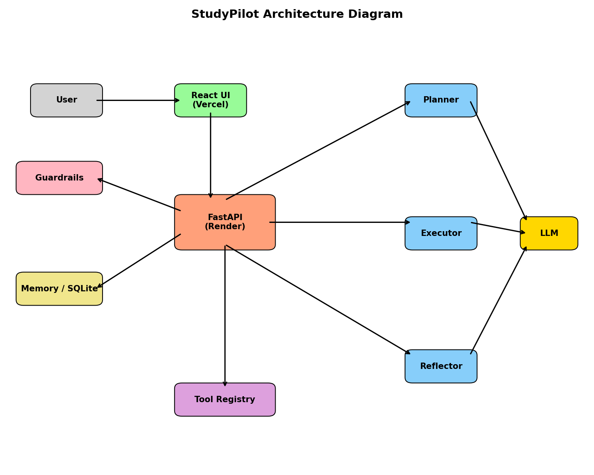

# StudyPilot 🎓 — Agentic AI Study & Research Assistant

> **DA-III: AI-Agent Development (Option i: Agentic Agent)**  
> Autonomous study & research agent implementing a native **Plan ➔ Act (with Tools) ➔ Observe ➔ Reflect ➔ Answer ➔ Remember** reasoning loop. Built with a decoupled **FastAPI (Render)** backend and a sleek **React + Vite + Tailwind CSS (Vercel)** frontend.

---



---

## 🌟 Key Highlights

- **Decoupled Modern Architecture**:
  - **Backend**: FastAPI with Server-Sent Events (SSE) streaming live agent events, pre-configured for **Render** via `render.yaml`.
  - **Frontend**: High-performance React 18 + Vite + Tailwind CSS + Lucide Icons client pre-configured for **Vercel** with full SPA routing (`vercel.json`).
- **Native Autonomous Agent Loop**: No LangChain / LlamaIndex overhead. Transparent, auditable tool calling designed for academic evaluation.
- **Enterprise-Grade Guardrails**:
  - Input length and empty string verification.
  - Regex prompt-injection neutralization.
  - Harmful request blocking (weapons, self-harm, cyberattacks).
  - SSRF protection in webpage scraping (prohibits private IPs, localhost, non-http schemes).
  - Safe AST evaluation for calculator operations (no `eval`/`exec`).
  - Automatic disclaimers for health, legal, and financial topics.
- **Dual-Tier Memory**:
  - Short-term conversational context.
  - Long-term SQLite persistence (`studypilot.db`) tracking study sessions, notes, and quiz history.
- **Study Accelerators**:
  - Animated flip **Flashcards** generated on demand from any agent answer.
  - Interactive **Multiple-Choice Quizzes** with real-time scoring, explanations, and score tracking.

---

## 🔄 How the Agent Loop Works

```
 ┌──────────┐      ┌───────────┐      ┌───────────┐
 │   User   │ ───► │Guardrails │ ───► │  Planner  │
 └──────────┘      └───────────┘      └─────┬─────┘
                                            │ Plan (2-4 steps)
                                            ▼
 ┌──────────┐      ┌───────────┐      ┌───────────┐
 │ Answer & │ ◄─── │ Reflector │ ◄─── │ Executor  │ ◄──► [Tools & Memory]
 │ Remember │      └───────────┘      └───────────┘
 └──────────┘       (Critic Pass)      (Act & Observe)
```

1. **PLAN**: Validates input and creates a 2–4 step strategic plan specifying required tools.
2. **ACT**: Calls external tools (DuckDuckGo, Wikipedia, Open-Meteo, Calculator, Notes).
3. **OBSERVE**: Analyzes tool outputs and compiles intermediate findings.
4. **REFLECT**: An automated critic pass checks groundedness against tool observations (permitting 1 autonomous revision).
5. **ANSWER**: Streams structured Markdown with citations and study aid triggers.
6. **REMEMBER**: Saves session history, notes, and quiz results in SQLite.

---

## 🛠️ Tech Stack

- **Backend**: Python 3.11, FastAPI, Uvicorn, SQLite3, Pydantic v2, SSE-Starlette
- **Frontend**: React 18, Vite, Tailwind CSS, Lucide Icons, React Markdown
- **LLM**: Groq Free API (`openai/gpt-oss-120b`, `qwen/qwen3.8-27b`)
- **Hosting**:
  - Backend: [Render](https://render.com) (Web Service)
  - Frontend: [Vercel](https://vercel.com) (Frontend SPA)

---

## ⚡ Quickstart: Local Development

### 1. Backend (Terminal 1)
```powershell
# Create & activate venv
python -m venv venv
.\venv\Scripts\activate

# Install requirements
pip install -r requirements.txt

# Run FastAPI server
uvicorn server:app --reload --port 8000
```
Backend API will be running at `http://localhost:8000` (docs at `http://localhost:8000/docs`).

### 2. Frontend (Terminal 2)
```powershell
cd frontend
npm install
npm run dev
```
Open your browser at `http://localhost:5173`.

---

## 🚀 1-Click Deployment (Render + Vercel)

### Backend on Render
1. Push this repository to GitHub.
2. On [render.com](https://render.com), create a new **Web Service** from your repo.
3. Build Command: `pip install -r requirements.txt`
4. Start Command: `uvicorn server:app --host 0.0.0.0 --port $PORT`
5. Add Environment Variable:
   - `GROQ_API_KEY`: your Groq API key

### Frontend on Vercel
1. On [vercel.com](https://vercel.com), create a **New Project** and import your repo.
2. Set **Root Directory** to `frontend`.
3. Add Environment Variable:
   - `VITE_API_BASE_URL`: your Render backend URL (e.g., `https://studypilot-api.onrender.com`)
4. Click **Deploy**. Vercel will build the frontend with zero 404 refresh errors using `vercel.json`.

---

## 📂 Repository Layout

```text
StudyPilot/
├── frontend/                   # React + Vite + Tailwind CSS frontend (Vercel)
│   ├── src/
│   │   ├── components/         # Sidebar, AgentTrace, FlashcardsModal, QuizModal
│   │   ├── App.jsx             # Main interactive chat application
│   │   └── api.js              # REST & SSE client communication
│   ├── index.html              # Splash screen & root HTML
│   ├── vercel.json             # SPA routing rewrite rule
│   └── package.json
├── server.py                   # FastAPI backend server (Render entrypoint)
├── render.yaml                 # Render blueprint configuration
├── vercel.json                 # Fallback root SPA rewrite configuration
├── cli.py                      # Terminal CLI runner with live trace
├── requirements.txt            # Python dependencies (FastAPI, Uvicorn, OpenAI, etc.)
├── runtime.txt                 # Python 3.11 runtime
├── src/studypilot/
│   ├── api/routes.py           # FastAPI routes & SSE streaming
│   ├── agent/                  # Planner, Executor, Reflector, Orchestrator
│   ├── tools/                  # DuckDuckGo, Wiki, Webpage, Calculator, Weather
│   └── memory/                 # SQLite connection & CRUD store
├── tests/                      # Automated test suite (Pytest)
└── docs/                       # Architecture diagrams, decisions, and viva prep
```

---

## 📄 License

Distributed under the [MIT License](LICENSE).
