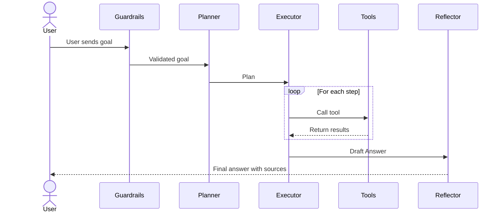
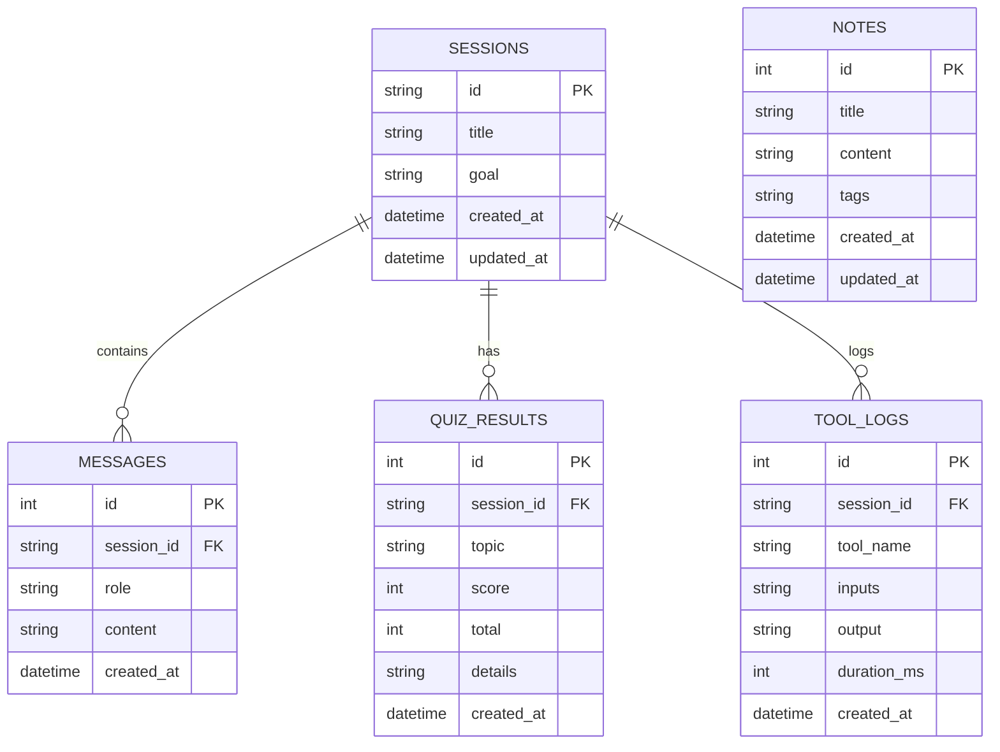

# StudyPilot Architecture & Schema

## 1. Architecture Diagram (Mermaid)
```mermaid
flowchart TD
    User([User]) --> UI[React + Vite Frontend (Vercel)]
    UI --> API[FastAPI Server (Render)]
    API --> Orch[Orchestrator]
    
    Orch --> Planner
    Planner --> LLM1[LLM]
    
    Orch --> Executor
    Executor --> LLM2[LLM]
    Executor --> ToolReg[Tool Registry]
    ToolReg --> Tools[web_search, wikipedia_summary, read_webpage, calculator, weather, notes, flashcards, quiz, datetime]
    Tools --> API[External APIs]
    
    Orch --> Reflector
    Reflector --> LLM3[LLM]
    
    Orch <--> Memory[(Memory/SQLite)]
    Guard[Guardrails] --> Orch
    Orch --> Guard
```

## 2. Sequence Diagram (Mermaid)


## 3. ER Diagram (Mermaid)


## 4. Tool Reference Table
| Tool Name | Function | Input Parameters | Output | External API Used |
|---|---|---|---|---|
| web_search | Search the web | query, max_results | Search results | DuckDuckGo |
| wikipedia_summary | Get a summary of a topic | topic | Text summary | Wikipedia |
| read_webpage | Read text from URL | url | Webpage text | None |
| calculator | Evaluate math expressions | expression | Result value | None |
| weather | Get current weather | city | Weather info | Weather API |
| save_note | Save note to memory | title, content | Note ID | None |
| search_notes | Search saved notes | query | List of notes | None |
| list_notes | List all saved notes | None | List of notes | None |
| make_flashcards | Generate flashcards | topic, notes_text | Flashcards format | None |
| make_quiz | Generate MC quiz | topic, notes_text, n | Quiz questions | None |
| current_datetime | Get current datetime | None | Datetime string | None |

## 5. Agent Loop Explanation
The agent loop follows a cycle: Plan -> Act -> Observe -> Reflect -> Answer -> Remember. First, the orchestrator passes the user's goal to the Planner, which generates a step-by-step strategy. During the Act phase, the Executor calls specific tools to accomplish each step. In the Observe phase, the agent incorporates the results returned by these tools. Once a draft is formed, the Reflector reviews it for accuracy and completeness. Finally, the Final Answer is presented to the user, and the interaction is saved to Remember in long-term memory.
